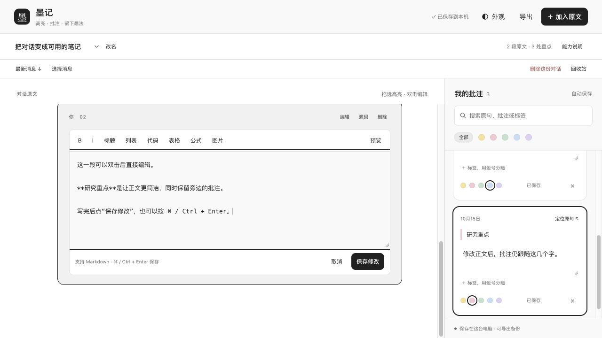

# 墨记 · Codex Conversation Notes

把值得反复阅读的 Codex 对话整理成可编辑的笔记，划出重点，在旁边写批注，再带走为 PDF 或 Word。

**macOS 本机测试版 · v0.6.1 · 对话和批注保存在本机**

## 下载与安装

1. [下载 macOS 安装包](https://github.com/TR-UE/codex-conversation-notes/releases/download/v0.6.1/codex-conversation-notes-0.6.1-macOS.zip)，解压后双击 `安装.command`。
2. 重启支持本地插件的 Codex / ChatGPT 桌面应用，在个人插件目录中启用“墨记”。
3. 在新聊天中选择墨记并发送：**打开墨记，导入这段对话。** 也可以双击包内的 `打开墨记.command` 使用本机阅读面板。

需要 Python 3.9 或以上和支持本地插件的 Codex CLI。安装器优先使用桌面应用提供的运行环境。PDF / Word 导出还需要捆绑文档环境中的 Python 文档库、Node.js 22+、Sharp 和 LibreOffice；安装时自动检测，详见 [安装与排错](docs/INSTALL.md)。macOS 已验证，其他平台尚未验证。

安装与更新会保留已有笔记，以及个人插件目录中的其他插件。发布包不包含个人对话、批注、数据库、账号凭据或本机固定路径。

## 可以做什么

- **高亮与侧边批注**：五种颜色、标签、搜索、自动保存，点击批注定位到原句。
- **直接编辑正文**：双击消息进入编辑框，用键盘修改；提供格式按钮、预览、保存和撤销。
- **保留阅读格式**：加粗、列表、表格、代码高亮、公式、图片与大图查看。
- **整理长对话**：同步已关联聊天的新消息，保留阅读位置；修改标题、删减文字、选择消息、回收站和跨刷新撤销。
- **富格式导出**：PDF / Word 保留加粗、表格、公式、图片、高亮和批注；Word 正文与表格可编辑，PDF 带可点击的页边批注。
- **备份与外观**：JSON 完整备份与恢复、Markdown 批注笔记，简约、纸页、雾蓝三种风格及明暗模式。

公式以高清图形嵌入 Word 和 PDF，暂不是可编辑的 Word 原生数学对象。导出按纸张分页，换行和屏幕背景可能与阅读面板不同。远程图片无法下载或需要登录时，文档会注明原因并保留链接。

## 演示




截图使用独立演示数据，不包含真实用户对话。

## 数据与隐私

默认数据位置为 `~/.codex/conversation-notes/notes.sqlite3`，本机图片快照位于同目录 `images/`。这些文件独立于插件安装目录，更新和重新安装不会清空笔记。

只导入用户指定的聊天或粘贴的摘录，不扫描其他聊天正文；不保存系统消息、隐藏推理和工具调用内容。阅读面板只监听本机回环地址，修改请求检查来源与随机令牌。对话和批注不上传，远程图片在用户加载或导出时访问原图片服务。详见 [数据说明](docs/PRIVACY.md)。

## 当前边界

- 精确选区、高亮和批注定位发生在墨记阅读面板内。公开接口尚未提供原生 Codex 聊天区选区读取或消息级定位；“返回原聊天”只能打开对应聊天。
- 本机聊天导入依赖用户指定会话的 JSONL 格式；云端聊天可复制需要的文字导入。
- 已验证的是 Codex 内置浏览器中的本机面板，原生 MCP App 宿主视图仍待单独验证。
- 本项目独立开发，未上架 OpenAI 公共插件目录。发布到 GitHub 与插件目录上架是不同流程。

## 开发与验证

源码位于 `plugin/conversation-notes/`，浏览器依赖、公式字体及导出解析器已打包，不需要在使用时安装 npm 依赖。`export-runtime.json` 由每位使用者在本机生成，不进入 Git 或安装包。

```sh
python3 plugin/conversation-notes/scripts/configure_runtime.py
# 使用上一步检测到的文档 Python：
PYTHONPATH=plugin/conversation-notes python3 -m unittest discover -s plugin/conversation-notes/tests -v
node plugin/conversation-notes/tests/rich-text.test.cjs
python3 scripts/package-plugin.py
python3 tests/install_smoke.py
```

文档测试需要使用桌面应用的文档 Python，具体命令见 [安装说明](docs/INSTALL.md)。41 项回归测试覆盖存储、编辑、锚点、同步、删减、改名、图片与文档导出；另有独立安装和带空格路径检查。验证范围见 [验证记录](docs/VERIFICATION.md)，版本变化见 [CHANGELOG](CHANGELOG.md)。

## 反馈与许可证

请在 Issues 提供版本、操作步骤、期望结果和实际结果，并移除私人对话与凭据。本项目暂未指定开源许可证；随包第三方依赖按各自许可证使用，见 `plugin/conversation-notes/web/vendor/THIRD-PARTY-LICENSES.txt`。
